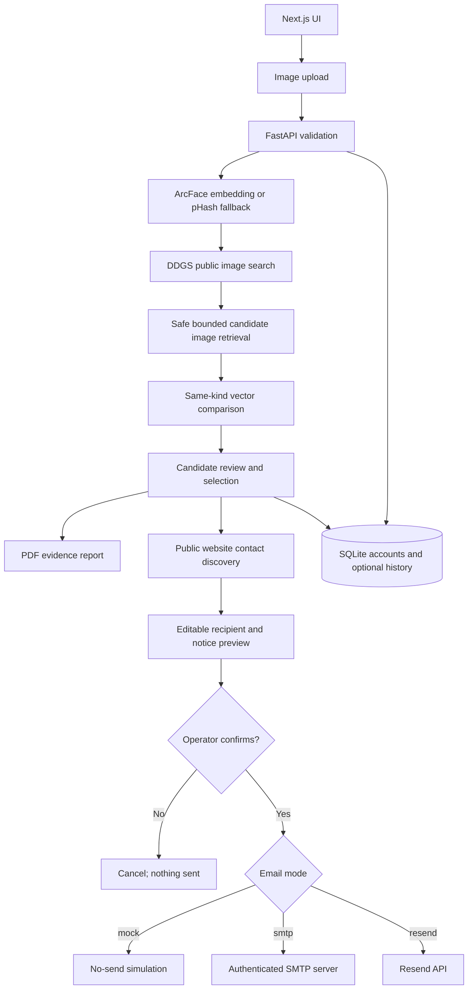

# DeepShield

**Candidate image search, evidence reporting, and operator-reviewed email workflow.**

[](https://github.com/MR-MK47/DeepShield/actions/workflows/ci.yml)

DeepShield is a prototype that helps an operator look for public images resembling a supplied reference image, review candidate URLs and similarity scores, preserve selected candidate metadata in a PDF report, and prepare a carefully reviewed email to the website hosting a result.

> **Important:** DeepShield is not a deepfake detector and it does not decide whether content is synthetic, unlawful, non-consensual, or impersonating someone. Similarity is a lead for human review, not proof. Verify the source, facts, contact address, legal basis, and notice text before taking action.

## Contents

- [What it does](#what-it-does)
- [How the system works](#how-the-system-works)
- [Technology stack](#technology-stack)
- [Repository layout](#repository-layout)
- [Prerequisites](#prerequisites)
- [Running on Any PC (1-Click, Docker, or Manual)](#running-on-any-pc)
- [Environment configuration](#environment-configuration)
- [Email delivery and test email](#email-delivery-and-test-email)
- [HTTP API reference](#http-api-reference)
- [Testing and CI](#testing-and-ci)
- [Security, privacy, and operational notes](#security-privacy-and-operational-notes)
- [Troubleshooting](#troubleshooting)
- [Current limitations and future improvements](#current-limitations-and-future-improvements)

## What it does

- **Reference-image analysis:** validates an uploaded image, attempts to extract a 512-dimensional ArcFace embedding, and calculates a typed perceptual image hash.
- **Public candidate search:** uses public image-search results and compares compatible query/candidate vectors. The search is bounded and only considers images the provider makes discoverable and the source server allows the app to retrieve.
- **Candidate review:** displays source domains, URLs, and similarity scores so the operator can open and verify each result.
- **Optional scan history:** saves candidate metadata only after the operator explicitly checks the history option while signed in. Saved entries can be viewed and deleted.
- **Evidence PDF:** creates a downloadable PDF of operator-selected candidate findings; it is an evidence summary, not a forensic certification.
- **Website contact discovery:** checks a matched website's public homepage and common contact, privacy, and terms pages for visible email addresses. Each suggestion includes the page where it was found. A suggestion is not proof that the address is the correct grievance/legal inbox.
- **Reviewed notice workflow:** allows the operator to edit the recipient, inspect the exact notice draft, and explicitly confirm before dispatch.
- **Email delivery options:** local no-send test mode, authenticated SMTP (including a test email to the signed-in operator's registered email), or Resend when a verified sender domain is configured.
- **Operator accounts:** registration, login, logout, expiring bearer sessions, and per-user history using a local SQLite database.

## How the system works

The current web UI uses the separate analyse-then-search calls described below. The backend also exposes a combined `/api/scan` endpoint for clients that prefer a single upload/search request.

### End-to-end workflow

1. **Upload a reference image.** The frontend checks that the selected file is an image and is no larger than 10 MB. The backend independently checks the byte limit, image decoding, and maximum pixel count.
2. **Build a query representation.** InsightFace/ArcFace is loaded lazily and, when available, extracts a 512-D embedding for the largest detected face. The backend also computes a typed perceptual hash. If face analysis is unavailable or no face is detected, it may use a pHash-derived 512-D fallback vector.
3. **Search public image results.** The backend gathers candidate image URLs from the DDGS public-search library, optionally using the user's search text and fallback terms. It downloads candidate images with timeouts and size limits, checks that they are public HTTP(S) image URLs, and evaluates them in a bounded worker pool.
4. **Compare like with like.** The engine only compares candidates using the same vector kind. ArcFace embeddings and pHash fallback vectors represent different mathematical spaces; comparing them to one another would be meaningless, so mismatched kinds are skipped.
5. **Review candidates.** The UI shows results above the selected similarity threshold. Similarity depends on the reference image, model/fallback, public search results, image availability, and threshold. High similarity does **not** prove a deepfake or a copyright/privacy violation.
6. **Choose an action.** The operator can select candidate(s) for an evidence PDF or select exactly one candidate for a notice.
7. **Discover and verify a recipient.** The app requests public contact pages on the matched website. The operator chooses a suggestion or enters a verified email address manually. The app displays source links for discovered addresses.
8. **Review the notice.** The backend creates an operator-bound, short-lived preview containing the selected URL, evidence signature, recipient, and exact draft. A preview expires after 15 minutes and can be dispatched once by the operator who created it.
9. **Send only after confirmation.** In mock mode nothing is sent. In SMTP or Resend mode the backend submits the reviewed notice to the configured delivery provider. The UI displays the provider/server response and message reference when supplied. Acceptance is not proof of inbox delivery or content removal.

### Architecture



The diagram is a conceptual flow. The reference image and vectors are processed by the backend, but the application code does not intentionally persist them in the account database. Network calls, model caches, runtime temporary files, host logs, and external providers still matter for a complete deployment/privacy assessment.

## Technology stack

| Area | Technology | Purpose |
|---|---|---|
| Frontend framework | Next.js 14, React 18 | Pages, client-side UI, and component composition |
| Frontend language | TypeScript | Typed API requests and UI state |
| Styling | Tailwind CSS 3 | Responsive dark UI and layout |
| Backend framework | FastAPI | REST API, request handling, validation, and OpenAPI docs |
| API schemas | Pydantic | Request and response validation |
| Face representation | InsightFace / ArcFace | Optional 512-D face embedding and face detection |
| Model runtime | ONNX Runtime | Inference for InsightFace models |
| Image handling | Pillow, NumPy, OpenCV runtime dependency | Decode, validate, transform, and analyse images |
| Perceptual hashing | ImageHash pHash; optional `pdqhash` integration | Image signatures; PDQ support is optional and requires installing its separate package |
| Public image search | DDGS | Collect public image-result URLs |
| HTTP retrieval | Requests | Bounded downloads of public candidate images and contact pages |
| Authentication/storage | SQLite, Python `hashlib`, `secrets` | Local operator accounts, password hashes, hashed session tokens, and optional scan history |
| PDF reporting | ReportLab | Create downloadable evidence-summary PDFs |
| Email delivery | Python `smtplib` / TLS, Resend Python SDK | SMTP mailbox sending or Resend API delivery |
| Testing | pytest, FastAPI TestClient/httpx; Node source smoke test | Backend tests and frontend source checks |
| CI | GitHub Actions | Backend tests, frontend smoke tests, lint, and production build |

## Repository layout

```text
DeepShield/
├── backend/
│   ├── main.py                    # FastAPI app and HTTP endpoints
│   ├── requirements.txt           # Python dependencies
│   ├── .env.example               # Backend configuration template
│   ├── services/
│   │   ├── auth.py                # SQLite accounts, hashed passwords/sessions, optional history
│   │   ├── face_engine.py         # ArcFace embeddings and typed pHash fallback
│   │   ├── hash_engine.py         # Perceptual hash calculation/comparison
│   │   ├── osint_search.py        # Public candidate search/download/similarity pipeline
│   │   ├── contact_discovery.py   # Same-site public email discovery
│   │   ├── legal_email.py         # Notice generation plus mock/SMTP/Resend delivery
│   │   └── pdf_dossier.py         # Candidate evidence PDF
│   ├── test_phase1_legal.py       # Notice, email, and authentication workflow tests
│   ├── test_phase2.py             # API, upload, search, history, and contact tests
│   └── test_phase2_dossier.py     # PDF dossier tests
├── frontend/
│   ├── src/app/                   # Next.js pages/routes
│   │   ├── page.tsx               # Landing page
│   │   ├── scan/                  # Scan dashboard and workflow
│   │   ├── login/                 # Operator login
│   │   ├── signup/                # Operator registration
│   │   └── history/               # Saved scan history
│   ├── src/components/
│   │   ├── ImageUploader.tsx      # Upload, query, threshold, and save-history option
│   │   ├── MatchGrid.tsx          # Candidate result review and selection
│   │   └── ActionPanel.tsx        # PDF, editable recipient, preview, and dispatch
│   ├── src/lib/api.ts             # Typed frontend-to-backend API client
│   ├── package.json
│   ├── package-lock.json
│   └── .env.example               # Frontend API URL template
├── .github/workflows/ci.yml       # Automated test/lint/build checks
├── run.bat                        # Convenience launcher for Windows after setup
└── .gitignore                     # Excludes secrets, caches, local DBs, and build output
```

## Prerequisites

- **Python 3.11** is the version used by backend CI.
- **Node.js 20 LTS** is the version used by frontend CI, plus npm.
- Git for cloning and updating the repository.
- Network access for public image search and remote candidate retrieval.
- If using real ArcFace inference, InsightFace may need to download its model files at first analysis. For a quick offline-safe test, the pHash fallback can be enabled.
- To send actual email: SMTP credentials for a mailbox you control, or a Resend API key **and** a sender address on a domain verified in Resend. An API key alone is not enough to send through a verified external sender.

## Running on Any PC

DeepShield can be run on any PC (Windows, macOS, Linux) using one of three methods:

### Option 1: 1-Click Smart Launcher (Recommended)

The repository includes smart launcher scripts that automatically detect missing virtual environments, install required Python and npm dependencies, create default `.env` files if missing, and launch both the backend and frontend servers.

#### On Windows:
Double-click [run.bat](file:///c:/Users/mkazi/OneDrive/Desktop/DeepShield/run.bat) or run in PowerShell/CMD:
```cmd
run.bat
```

#### On macOS / Linux:
Make the script executable and run:
```bash
chmod +x run.sh
./run.sh
```

---

### Option 2: Run Anywhere with Docker (Zero Manual Installs)

If you have [Docker Desktop](https://www.docker.com/products/docker-desktop/) or Docker Engine installed, you can launch the complete stack with a single command without needing local Python or Node installations:

```bash
docker compose up --build
```

- **Frontend Dashboard:** [http://localhost:3000](http://localhost:3000)
- **Backend API Docs:** [http://localhost:8000/docs](http://localhost:8000/docs)

---

### Option 3: Manual Step-by-Step Setup

#### Prerequisites
- **Python 3.10 or 3.11** installed.
- **Node.js 18+ or 20 LTS** & npm installed.
- Git.

#### Windows Manual Setup

**Terminal 1 — Backend (PowerShell):**
```powershell
cd backend
python -m venv venv
.\venv\Scripts\Activate.ps1
python -m pip install --upgrade pip

# Try installing full requirements (with InsightFace)
pip install -r requirements.txt
# If InsightFace fails due to missing C++ build tools, install the core requirements instead:
# pip install -r requirements-core.txt

if (!(Test-Path .env)) { Copy-Item .env.example .env }
uvicorn main:app --reload --port 8000
```

**Terminal 2 — Frontend (PowerShell):**
```powershell
cd frontend
if (!(Test-Path .env.local)) { Copy-Item .env.example .env.local }
npm install
npm run dev
```

#### macOS & Linux Manual Setup

**Terminal 1 — Backend:**
```bash
cd backend
python3 -m venv venv
source venv/bin/activate
pip install --upgrade pip
pip install -r requirements.txt || pip install -r requirements-core.txt
[ -f .env ] || cp .env.example .env
uvicorn main:app --reload --port 8000
```

**Terminal 2 — Frontend:**
```bash
cd frontend
[ -f .env.local ] || cp .env.example .env.local
npm install
npm run dev
```

Open [http://localhost:3000](http://localhost:3000) in your browser.

## Environment configuration

Keep your personal `.env` files local. They are ignored by Git. **Pulling or switching branches will not update an existing local `.env`**, so add newly needed variables manually instead of overwriting your credentials.

### Backend: `backend/.env`

| Variable | Purpose | Default / notes |
|---|---|---|
| `NOTICE_EMAIL_MODE` | Select the notice transport | `mock` by default; options are `mock`, `smtp`, and `resend` |
| `RESEND_API_KEY` | API key for Resend | Needed only for Resend mode; keep secret |
| `RESEND_FROM_EMAIL` | Resend sender identity | Must use a domain verified in your Resend account for external recipients; the shared test sender is blocked by the app for arbitrary external contacts |
| `SMTP_HOST` | SMTP server hostname | Gmail example: `smtp.gmail.com` |
| `SMTP_PORT` | SMTP port | `587` for STARTTLS; `465` for implicit TLS |
| `SMTP_USERNAME` | SMTP login name | For Gmail, usually the sending Gmail address |
| `SMTP_PASSWORD` | SMTP password/app password | For Gmail, use an App Password, not the normal account password |
| `SMTP_FROM_EMAIL` | Sender shown in the message | Use an address permitted by the authenticated SMTP account; if blank, code falls back to the SMTP username |
| `CORS_ORIGINS` | Allowed browser origins, comma-separated | Local default: `http://localhost:3000,http://127.0.0.1:3000` |
| `AUTH_DB_PATH` | SQLite database path | Empty uses `backend/deepshield_auth.db` |
| `MAX_UPLOAD_BYTES` | Maximum uploaded image size | `10485760` (10 MiB) |
| `MAX_IMAGE_PIXELS` | Maximum decoded image pixels | `20000000` |
| `LOG_LEVEL` | Python logging level | `INFO` |
| `DEEPSHIELD_DISABLE_FACE_MODEL` | Skip InsightFace and use pHash fallback | Set to `1` for quick/offline tests |
| `INSIGHTFACE_ROOT` | Model cache/root directory | Defaults to `backend/.insightface` |
| `INSIGHTFACE_MODEL` | InsightFace model pack | Defaults to `buffalo_l` |

### Frontend: `frontend/.env.local`

| Variable | Purpose | Default |
|---|---|---|
| `NEXT_PUBLIC_API_URL` | Backend API base URL | `http://localhost:8000` |

Only put public, browser-safe values in `NEXT_PUBLIC_*` variables. Never place API secrets there.

## Email delivery and test email

The application intentionally defaults to **mock mode**. Mock mode exercises the confirmation workflow but never sends an email. Automated tests also mock the transport; CI does not send real messages.

### SMTP: prove delivery through your own mailbox

For a local demonstration, Gmail SMTP is one option. Google requires 2-Step Verification to create an App Password, and some managed or Advanced Protection accounts may not offer the feature. Follow Google's [official App Password instructions](https://support.google.com/accounts/answer/185833?hl=en).

Example values for `backend/.env`:

```dotenv
NOTICE_EMAIL_MODE=smtp
SMTP_HOST=smtp.gmail.com
SMTP_PORT=587
SMTP_USERNAME=youraddress@gmail.com
SMTP_PASSWORD=your_16_character_app_password
SMTP_FROM_EMAIL=youraddress@gmail.com
```

Replace all example values with credentials for an account you control. Never commit the app password.

After restarting the backend:

1. Sign in to DeepShield with an operator account whose registered email address you can access.
2. Click **Send test email** in the scan page header.
3. Confirm the prompt. The test endpoint sends only to the signed-in operator's registered email; it does not take an arbitrary address supplied by the browser.
4. Check the inbox and Spam/Junk folder. The UI reports the SMTP server's acceptance and the message ID. Server acceptance is evidence that SMTP accepted the submission, but it cannot guarantee inbox placement.

The signed-in DeepShield email does **not** need to be the same address as the configured SMTP sender. The test is sent by `SMTP_USERNAME` to the registered email on the operator account. For reviewed notices, the recipient is the editable address shown in the preview.

### Reviewed notice dispatch

In `smtp` mode, the app submits a confirmed notice through SMTP. In `resend` mode, the app submits it through Resend and requires a usable `RESEND_API_KEY` plus a sender address on your verified domain. In `mock` mode, no email is sent.

The notice flow is deliberately guarded:

- a signed-in operator selects exactly one candidate;
- the website contact is suggested from public pages, but remains editable;
- the exact recipient and draft are shown before dispatch;
- the backend stores a random preview token tied to that operator for up to 15 minutes;
- the preview is consumed after dispatch attempts to reduce accidental duplicate sends.

Use only a verified, appropriate destination and truthful factual claims. Verify the complaint details before dispatch. Sending a message does not mean the recipient has accepted the claim or removed content.

## HTTP API reference

The backend is FastAPI. Visit `/docs` while it is running for interactive OpenAPI documentation.

| Method | Endpoint | Purpose | Authentication |
|---|---|---|---|
| `GET` | `/` | Basic health check | No |
| `GET` | `/api/health` | Health status | No |
| `POST` | `/api/auth/register` | Create an operator account | No |
| `POST` | `/api/auth/login` | Authenticate and receive a bearer token | No |
| `GET` | `/api/auth/me` | Return the current operator | Bearer token |
| `POST` | `/api/auth/logout` | Revoke the current token when supplied | Token optional |
| `POST` | `/api/analyze` | Validate an image and return a typed vector and image hash | No |
| `POST` | `/api/search` | Search candidates from a previously generated vector | Token optional; required to save history |
| `POST` | `/api/scan` | Combined image upload, analysis, and search | Token optional; required to save history |
| `GET` | `/api/matches` | List the signed-in operator's saved scans | Bearer token |
| `DELETE` | `/api/matches/{scan_id}` | Delete one of the operator's saved scans | Bearer token |
| `POST` | `/api/dossier` | Generate a PDF from supplied candidate metadata | Bearer token |
| `POST` | `/api/email/test` | Send a real SMTP test email to the signed-in operator's profile email | Bearer token; SMTP mode |
| `POST` | `/api/takedown/contact-suggestions` | Search public contact pages for email suggestions | Bearer token |
| `POST` | `/api/takedown/preview` | Create the recipient-bound notice preview | Bearer token |
| `POST` | `/api/legal-notice` | Alias for the notice-preview endpoint | Bearer token |
| `POST` | `/api/takedown/email` | Submit a previously reviewed preview | Bearer token |

### Useful request details

- Image endpoints accept multipart form-data uploads.
- `/api/search` accepts a 512-value vector, optional `query_text`, a similarity `threshold` from 0 to 1, and an optional `save_history` flag.
- `/api/scan` accepts multipart fields `file`, optional `query_text`, `threshold`, and `save_history`.
- Protected routes use `Authorization: Bearer <token>`.
- Preview dispatch requires the `preview_id` returned by `/api/takedown/preview`; the backend does not accept the whole notice as a fresh dispatch payload.

## Testing and CI

### Backend tests

Windows PowerShell:

```powershell
cd backend
.\venv\Scripts\Activate.ps1
$env:DEEPSHIELD_DISABLE_FACE_MODEL = "1"
python -m pytest -q
```

macOS/Linux:

```bash
cd backend
DEEPSHIELD_DISABLE_FACE_MODEL=1 python -m pytest -q
```

### Frontend tests and production build

```bash
cd frontend
npm ci
npm test
npm run lint
npm run build
```

### What the automated tests do

- exercise API validation, upload bounds, route authentication, typed query vectors, search pipelines, optional history storage/deletion, contact suggestions, and PDF generation;
- test notice preview/dispatch rules and SMTP/Resend code paths with mocked providers;
- test the frontend source wiring for important flows;
- run frontend lint and a Next.js production build in GitHub Actions.

**The tests do not send real emails or prove real mailbox delivery.** Use the authenticated SMTP test button and verify arrival in a mailbox you control when you need a live demonstration.

## Security, privacy, and operational notes

- **Keep secrets private.** Never commit `backend/.env`, SMTP app passwords, or Resend API keys. Rotate any credential that is accidentally exposed.
- **Image limits apply on the backend too.** The server restricts upload bytes and decoded pixel count; client-side checks are not treated as the only protection.
- **Remote URLs are untrusted.** Image/contact fetches check for public HTTP(S) destinations, block local/private address targets, impose time/size limits, and constrain contact-page redirects to the source host family. External websites can still change or block their pages.
- **Authentication is local and minimal.** Passwords are stored as PBKDF2-HMAC-SHA256 hashes, and opaque session tokens are stored as SHA-256 hashes. Session lifetime is seven days. This is a prototype authentication system; production deployment should include a security review, rate limiting, account recovery, monitoring, and deployment-appropriate session controls.
- **History is opt-in.** The application stores saved candidate URLs/domains, scores, signatures, query text, and timestamps in SQLite only when the operator explicitly opts in. This saved metadata can still be sensitive.
- **No intentional persistence of reference uploads or vectors.** These are processed in request flow rather than written to the application account database. This does not mean all data disappears from memory, temporary storage, model caches, logs, the browser, or external providers. Assess the complete deployment before making privacy/compliance claims.
- **Contact discovery is not verification.** Public pages may publish an obsolete, general-purpose, or wrong-department email. Open the source link and independently verify the address.
- **Evidence signatures have a limited meaning.** The candidate's `sha256:` signature identifies the downloaded file bytes; it does not prove who created the image or whether the image is authentic.
- **The PDF and legal notice are templates.** They are not legal advice, forensic certification, a determination of illegality, or a guarantee that a site will respond.
- **Similarity thresholds are not confidence in wrongdoing.** A 90% similarity score does not mean a 90% chance of a deepfake or offence.

## Troubleshooting

| Problem | What to check |
|---|---|
| Frontend can't reach the API | Confirm backend is running on port 8000, `NEXT_PUBLIC_API_URL` is correct, and `CORS_ORIGINS` includes the frontend origin |
| Upload is rejected | Check image format, file size (10 MiB default), pixel dimensions, and that the file is a decodable JPG/PNG/WEBP/GIF |
| Few or no candidates appear | Public search is best-effort; provider results may be irrelevant, blocked, stale, or unavailable. Try different query terms or review the threshold |
| ArcFace model won't load | Check logs and network access for first-use model download. Set `DEEPSHIELD_DISABLE_FACE_MODEL=1` to use the pHash fallback for development/testing |
| History cannot be saved | Sign in, check the save-history checkbox, and ensure the SQLite database path is writable |
| SMTP test returns 409 | Set `NOTICE_EMAIL_MODE=smtp` in `backend/.env` and restart the backend |
| SMTP test returns 502 | Confirm host, port, username, app password, sender address, 2-Step Verification, network access, and that the provider permits SMTP/app passwords |
| SMTP server accepts but no inbox message appears | Check Spam/Junk and the sending mailbox's sent items; use the message ID and provider/mail logs to investigate delivery |
| Resend refuses a recipient/sender | Use a valid API key and a sender address on a domain verified in Resend; the shared testing sender is not used for arbitrary external notice recipients |
| Notice preview expired or cannot be dispatched | Create a fresh preview and review it again. Previews expire after 15 minutes and are single-use |
| PDF generation fails | Review backend logs and confirm the selected candidates include the required URL/domain/similarity metadata |

## Current limitations and future improvements

- Search completeness depends on public search providers and the availability of third-party image URLs.
- ArcFace performance should be evaluated with a labelled, consent-appropriate dataset; pHash fallback is a visual/perceptual fallback, not biometric identity matching.
- Optional PDQ support requires separately installing a compatible `pdqhash` package; it is not installed by the default requirements file.
- Contact discovery checks a bounded list of common pages and may miss obfuscated, JavaScript-rendered, or directory-listed contacts.
- The local accounts/session subsystem has no email verification, password reset, MFA, rate limiting, or role administration.
- For production, consider a persistent, managed database; structured audit logs; strict outbound network policy; deployment secrets management; authenticated/rate-limited public endpoints; delivery webhooks; and end-to-end integration tests against a controlled recipient mailbox.
- A future version could add provider delivery-status tracking, a richer evidence timeline, configurable retention/deletion, and controlled evaluations of search recall and false-positive rates.

## License

MIT.
